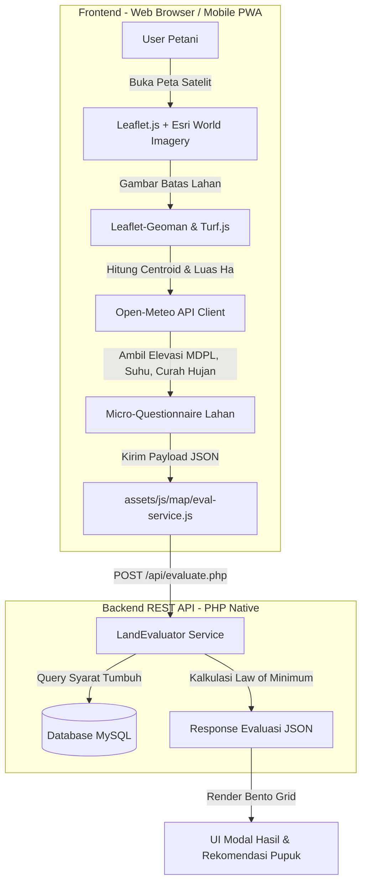

# 🌱 TerraSense Agri

[](https://www.php.net/)
[](https://www.mysql.com/)
[](https://tailwindcss.com/)
[](https://leafletjs.com/)
[](https://open-meteo.com/)
[](LICENSE)

> **Platform *Precision Agriculture* berbasis Web & GIS** untuk pemetaan poligon lahan satelit, evaluasi kesesuaian komoditas pertanian berbasis standar ilmiah Balai Penelitian Tanah (2003), kalkulasi dosis pupuk presisi, dan pelaporan hasil panen.

---

## 📌 Daftar Isi
- [Latar Belakang & Visi](#-latar-belakang--visi)
- [Fitur Utama](#-fitur-utama)
- [Arsitektur Sistem & Alur Evaluasi](#-arsitektur-sistem--alur-evaluasi)
- [Teknologi yang Digunakan](#-teknologi-yang-digunakan)
- [Struktur Direktori](#-struktur-direktori)
- [Panduan Instalasi & Menjalankan Lokal](#-panduan-instalasi--menjalankan-lokal)
- [Daftar Endpoint API](#-daftar-endpoint-api)
- [Metodologi Evaluasi Lahan](#-metodologi-evaluasi-lahan)
- [Keamanan (Security Measures)](#-keamanan-security-measures)
- [Kontributor & Lisensi](#-kontributor--lisensi)

---

## 🌾 Latar Belakang & Visi

Banyak petani lokal di Indonesia menghadapi kegagalan panen atau produktivitas suboptimal akibat ketidaksesuaian pemilihan komoditas dengan kondisi fisik lingkungan (suhu, elevasi, curah hujan, drainase, tekstur tanah) serta pemupukan yang tidak berimbang.

**TerraSense Agri** mentransformasikan data geospasial dan agro-klimat menjadi rekomendasi ilmiah yang praktis dan dapat diterapkan langsung di lapangan oleh petani:
1. **Memetakan lahan** secara mandiri menggunakan citra satelit resolusi tinggi.
2. **Mendeteksi agroklimat real-time** (MDPL, temperatur, curah hujan) secara otomatis via API terbuka.
3. **Mengevaluasi kesesuaian lahan** berdasarkan kaidah *Hukum Minimum* Balai Penelitian Tanah.
4. **Menghitung rekomendasi pupuk** (Urea, SP-36, KCl, NPK) spesifik luas dan jenis tanaman.
5. **Mencatat panen** untuk evaluasi efisiensi biaya dan produktivitas tiap musim tanam.

---

## ✨ Fitur Utama

### 1. 🗺️ Peta Interaktif & Pemetaan Satelit (GIS)
- **High-Resolution Satellite Layer**: Menggunakan layer Esri World Imagery dan OpenStreetMap.
- **Poligon Geoman Draw**: Fitur gambar, edit, dan hapus poligon batas lahan mandiri.
- **Perhitungan Geospasial Otomatis**: Luas area dalam Hektar (Ha) dan meter persegi ($m^2$), keliling, serta penetapan titik koordinat tengah (*centroid*) via **Turf.js**.

### 2. 🧪 Evaluasi Kesesuaian Lahan Ilmiah (`LandEvaluator`)
- **Deteksi Otomatis Lingkungan**: Mengambil elevasi (MDPL) dan parameter cuaca dari Open-Meteo API.
- **Micro-Questionnaire**: Menangkap karakteristik fisik lokal (tekstur tanah basah, kedalaman batuan efektif, dan riwayat genangan/banjir).
- **Klasifikasi Standar Nasional**:
  - **S1 (Sangat Sesuai)**: Lahan tidak memiliki faktor pembatas yang berarti.
  - **S2 (Cukup Sesuai)**: Memiliki faktor pembatas sedang yang dapat diatasi.
  - **S3 (Sesuai Marjinal)**: Memiliki pembatas berat yang memerlukan masukan tinggi.
  - **N (Tidak Sesuai)**: Memiliki pembatas permanen/sangat berat.
- **Deteksi Faktor Pembatas (*Limiting Factors*)**: Menjelaskan alasan ilmiah ketidaksesuaian (mis. suhu terlalu panas, elevasi di luar batas toleransi, drainase buruk).

### 3. ⚖️ Kalkulator Kebutuhan Pupuk Presisi
- Menghitung dosis pupuk standar anjuran untuk komoditas terpilih disesuaikan dengan luas lahan hasil gambar poligon.
- Menampilkan kebutuhan pupuk tunggal (Urea, SP-36, KCl) maupun pupuk majemuk (NPK Ponska).

### 4. 📊 Dashboard Analitik & Riwayat Panen
- Statistik total lahan aktif, total estimasi panen, dan distribusi status kesesuaian lahan.
- Pencatatan log panen per lahan lengkap dengan kuantitas (ton/kg), tanggal panen, kualitas mutu, dan catatan lapangan.

### 5. 🔐 Autentikasi & Manajemen Pengguna
- Registrasi dan login dengan enkripsi password `bcrypt` (`PASSWORD_DEFAULT`).
- Proteksi sesi aman (`HttpOnly`, `SameSite=Lax`, `Cookie-Secure`).
- Alur *Forgot Password* & *Reset Password* menggunakan token kriptografis berbatas waktu (expiry).
- Pengaturan profil pengguna dengan upload foto avatar (validasi MIME, sanitasi nama berkas, dan batasan ukuran 2MB).

---

## 🏛️ Arsitektur Sistem & Alur Evaluasi



### Alur Evaluasi Lahan (*The Evaluation Pipeline*):
1. **Draw & Capture**: Pengguna menggambar poligon lahan pada peta satelit.
2. **Spatial Math**: Turf.js menghitung luas area dalam hektar dan mengekstrak koordinat centroid `(lat, lng)`.
3. **Live Weather & Elevation**: Aplikasi meminta data elevasi dan cuaca aktual dari Open-Meteo secara asinkron.
4. **User Interception**: Modal 3 pertanyaan lokal muncul untuk mengonfirmasi tekstur tanah, kedalaman efektif, dan riwayat banjir.
5. **Backend Evaluation**: Backend (`LandEvaluator.php`) membandingkan seluruh parameter fisik terhadap kriteria komoditas di database menggunakan algoritma *Hukum Minimum*.
6. **Result Presentation**: Antarmuka menyajikan kelas kesesuaian (S1/S2/S3/N), faktor pembatas terperinci, dan panduan takaran pupuk.

---

## 💻 Teknologi yang Digunakan

| Kategori | Teknologi | Deskripsi |
| :--- | :--- | :--- |
| **Backend** | PHP 8.1+ (Native) | REST API ringan, modular, PDO Prepared Statements, Secure Session. |
| **Database** | MySQL 8.0+ / MariaDB | Skema relasional untuk pengguna, poligon lahan, syarat tumbuh, panen. |
| **Frontend Styling** | Tailwind CSS (CDN/Custom) | Konsep desain Modern Heritage, palet earth-tone, responsif mobile. |
| **Peta & GIS** | Leaflet.js, Leaflet-Geoman | Render layer satelit Esri, manipulasi poligon gambar interaktif. |
| **Komputasi Spasial** | Turf.js | Penghitungan luas geometris poligon dan titik centroid presisi. |
| **External APIs** | Open-Meteo API | Layanan keyless untuk elevasi (MDPL) dan prakiraan cuaca real-time. |
| **Web Server** | Apache (Laragon / XAMPP) | URL routing, `.htaccess` headers security, dan sandbox folder. |

---

## 📂 Struktur Direktori

```text
TerraSense-Agri/
├── api/                             # REST API Endpoints (PHP)
│   ├── services/
│   │   └── LandEvaluator.php        # Mesin evaluasi kesesuaian lahan & pupuk
│   ├── auth.php                     # Endpoint login, register, check-session, logout
│   ├── evaluate.php                 # Endpoint evaluasi kesesuaian lahan
│   ├── farms.php                    # Endpoint CRUD data poligon lahan
│   ├── forgot-password.php          # Endpoint request & reset password via token
│   ├── harvests.php                 # Endpoint CRUD catatan panen
│   ├── migrate.php                  # Script migrasi skema database terpadu
│   ├── profile.php                  # Endpoint profil & upload avatar
│   └── seed.php                     # Script seeder data tanaman & syarat tumbuh
├── assets/
│   ├── css/
│   │   └── farm-map.css             # Styling khusus peta GIS & modal evaluasi
│   ├── data/
│   │   └── crops.json               # Data acuan komoditas lokal
│   ├── images/                      # Asset gambar & ikon komoditas
│   └── js/
│       ├── app.js                   # Inisialisasi navigasi & global toast helper
│       ├── auth.js                  # Handler form autentikasi client-side
│       ├── map.js                   # Entry point inisialisasi peta
│       └── map/                     # Arsitektur modul GIS terpisah
│           ├── env-service.js       # Fetcher elevasi & cuaca Open-Meteo
│           ├── eval-service.js      # Client request evaluasi lahan
│           ├── farm-gis.js          # Pengelola layer & poligon Leaflet
│           ├── farm-modal.js        # Pengendali form kuesioner & input lahan
│           ├── fertilizer-calc.js   # Kalkulasi pupuk di sisi browser
│           └── ui-renderer.js       # Renderer komponen UI & visual feedback
├── config/
│   └── database.php                 # Konfigurasi koneksi PDO & helper global
├── docs/                            # Dokumentasi arsitektur, PRD, dan skema
├── pages/                           # Tampilan Halaman Web (HTML)
│   ├── dashboard.html               # Halaman ringkasan analitik
│   ├── farm-map.html                # Halaman peta GIS & evaluasi lahan
│   ├── forgot-password.html         # Halaman permintaan reset password
│   ├── harvest-report.html          # Halaman pelaporan hasil panen
│   ├── login.html                   # Halaman masuk sistem
│   ├── profile.html                 # Halaman pengaturan profil & avatar
│   ├── register.html                # Halaman pendaftaran pengguna
│   └── reset-password.html          # Halaman formulir ganti password baru
├── sql/
│   └── schema.sql                   # Skema DDL MySQL lengkap
├── uploads/                         # Direktori upload media pengguna
│   ├── avatars/                     # File foto avatar pengguna
│   └── .htaccess                    # Sandbox pencegah eksekusi script
├── .htaccess                        # Proteksi root Apache
├── .gitignore                       # Aturan pengecualian Git
├── index.html                       # Landing page utama aplikasi
└── README.md                        # Dokumentasi proyek
```

---

## 🚀 Panduan Instalasi & Menjalankan Lokal

### Prasyarat
- **Web Server**: [Laragon](https://laragon.org/) (Sangat direkomendasikan di Windows) atau [XAMPP](https://www.apachefriends.org/).
- **PHP**: Versi 8.1 atau lebih baru (dengan ekstensi `pdo_mysql`, `curl`, `json`, `mbstring` aktif).
- **MySQL / MariaDB**: Port default 3306.
- **Git**

### Langkah 1: Kloning Repository
Buka terminal di direktori root server web Anda (misalnya `C:\laragon\www\`):
```bash
cd C:\laragon\www
git clone https://github.com/Asobirin29/TerraSense-Agri.git
cd TerraSense-Agri
```

### Langkah 2: Konfigurasi Database
Secara default, aplikasi telah dikonfigurasi di [`config/database.php`](config/database.php) untuk menggunakan:
- **Host**: `localhost`
- **Database**: `terrasense_db`
- **User**: `root`
- **Password**: *(kosong)*

Jika menggunakan username/password lain, Anda dapat menyesuaikan variabel di file tersebut atau menggunakan Environment Variable:
```env
TERRASENSE_ENV=development
TERRASENSE_URL=http://localhost/TerraSense-Agri
```

### Langkah 3: Eksekusi Migrasi & Data Seeder
Jalankan script migrasi otomatis untuk membuat tabel database dan seeder data awal komoditas:

**Opsi A — Lewat Terminal CLI (PHP):**
```bash
php api/migrate.php
php api/seed.php
```

**Opsi B — Lewat Browser:**
1. Pastikan Apache & MySQL di Laragon/XAMPP sudah dalam kondisi **Start**.
2. Buka URL:
   - Migrasi: `http://localhost/TerraSense-Agri/api/migrate.php`
   - Seeder: `http://localhost/TerraSense-Agri/api/seed.php`

*(Catatan: Endpoint migrasi dan seed dilindungi oleh `requireLocalAccess()` sehingga hanya dapat diakses dari IP `127.0.0.1` / `::1`).*

### Langkah 4: Buka Aplikasi di Browser
Buka browser dan navigasikan ke:
```text
http://localhost/TerraSense-Agri/
```
Anda dapat langsung mendaftarkan akun baru melalui halaman **Daftar** atau menggunakan data akun uji coba jika tersedia.

---

## 📡 Daftar Endpoint API

Semua endpoint mengembalikan respon berformat `application/json; charset=utf-8`.

| Method | Endpoint | Fungsi | Autentikasi |
| :--- | :--- | :--- | :---: |
| `POST` | `/api/auth.php?action=register` | Registrasi akun baru | Bebas |
| `POST` | `/api/auth.php?action=login` | Login & inisialisasi sesi | Bebas |
| `GET` | `/api/auth.php?action=check` | Cek status sesi aktif saat ini | Sesi |
| `POST` | `/api/auth.php?action=logout` | Hapus sesi login | Sesi |
| `POST` | `/api/forgot-password.php?action=request` | Buat token reset kata sandi | Bebas |
| `POST` | `/api/forgot-password.php?action=reset` | Reset kata sandi dengan token | Bebas |
| `GET` | `/api/farms.php` | Ambil daftar lahan milik pengguna | Sesi |
| `POST` | `/api/farms.php` | Simpan poligon & data lahan baru | Sesi |
| `DELETE` | `/api/farms.php?id={id}` | Hapus data lahan | Sesi |
| `POST` | `/api/evaluate.php` | Evaluasi kesesuaian lahan untuk komoditas | Bebas / Sesi |
| `GET` | `/api/harvests.php` | Ambil riwayat catatan panen | Sesi |
| `POST` | `/api/harvests.php` | Tambah log panen baru | Sesi |
| `GET` | `/api/profile.php` | Ambil data profil pengguna | Sesi |
| `POST` | `/api/profile.php` | Update identitas & upload avatar | Sesi |

---

## 🧪 Metodologi Evaluasi Lahan

Evaluasi kesesuaian lahan di TerraSense Agri mengacu pada buku panduan teknis **Kesesuaian Lahan untuk Komoditas Tanaman Pertanian** yang diterbitkan oleh **Balai Penelitian Tanah (2003)**.

### Prinsip *The Law of Minimum* (Hukum Faktor Terendah):
Jika suatu komoditas memiliki parameter suhu bernilai **S1 (Sangat Sesuai)**, elevasi **S1**, tekstur tanah **S2 (Cukup Sesuai)**, namun riwayat banjir adalah **S3 (Sesuai Marjinal)**, maka kelas kesesuaian akhir lahan tersebut ditetapkan menjadi **S3** dengan faktor pembatas utama: **Bahaya Banjir / Genangan**.

### Matriks Parameter Fisik yang Dianalisis:
1. **Temperatur Rata-rata Tahunan (°C)** — dari Open-Meteo.
2. **Elevasi Tempat (MDPL)** — dari Open-Meteo Elevation Model.
3. **Curah Hujan Rata-rata Tahunan (mm/tahun)** — estimasi klimatologis.
4. **Tekstur Tanah** — halus (lempung), sedang, kasar (pasir).
5. **Kedalaman Efektif Batuan (cm)** — kedalaman solum perakaran.
6. **Bahaya Genangan / Riwayat Banjir** — F0 (bebas), F1 (kadang), F2 (sering).

---

## 🛡️ Keamanan (Security Measures)

- **Prepared Statements (PDO)**: Seluruh query database menggunakan parameter binding untuk mengeliminasi celah *SQL Injection*.
- **Apache Hardening ([.htaccess](.htaccess))**: Memblokir akses publik ke berkas sensitif (`.sql`, `.env`, `.md`, `.tar`, `.zip`, dll.) serta folder internal sistem.
- **Upload Sandbox ([uploads/.htaccess](uploads/.htaccess))**: Mematikan eksekusi script PHP/CGI di dalam folder upload foto avatar guna mencegah serangan *Arbitrary File Upload*.
- **Password Hashing**: Menggunakan algoritma `PASSWORD_DEFAULT` (bcrypt dengan adaptive cost).
- **Session Protection**: Cookie sesi dikonfigurasi dengan flag `HttpOnly` (mencegah XSS membaca token sesi), `SameSite=Lax` (mitigasi CSRF), dan `Secure` otomatis saat berjalan di protokol HTTPS.

---

## 👨‍💻 Kontributor & Lisensi

Dikembangkan dengan dedikasi untuk kemajuan teknologi pertanian presisi di Indonesia.

- **Repository**: [https://github.com/Asobirin29/TerraSense-Agri](https://github.com/Asobirin29/TerraSense-Agri)
- **Author**: [Asobirin29](https://github.com/Asobirin29)

Didistribusikan di bawah lisensi **MIT License**. Silakan gunakan, kembangkan, dan berkontribusi untuk pertanian yang lebih presisi dan sejahtera! 🌾🇮🇩
